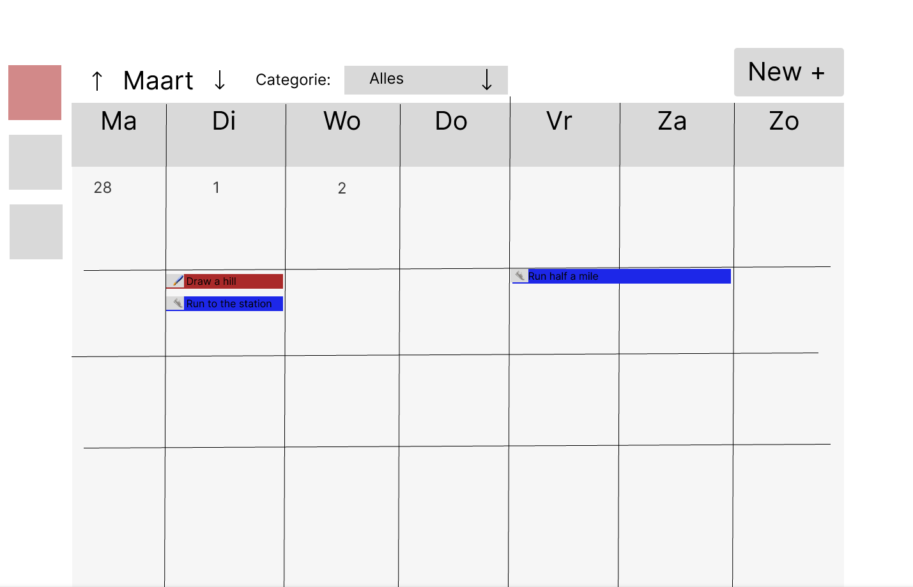
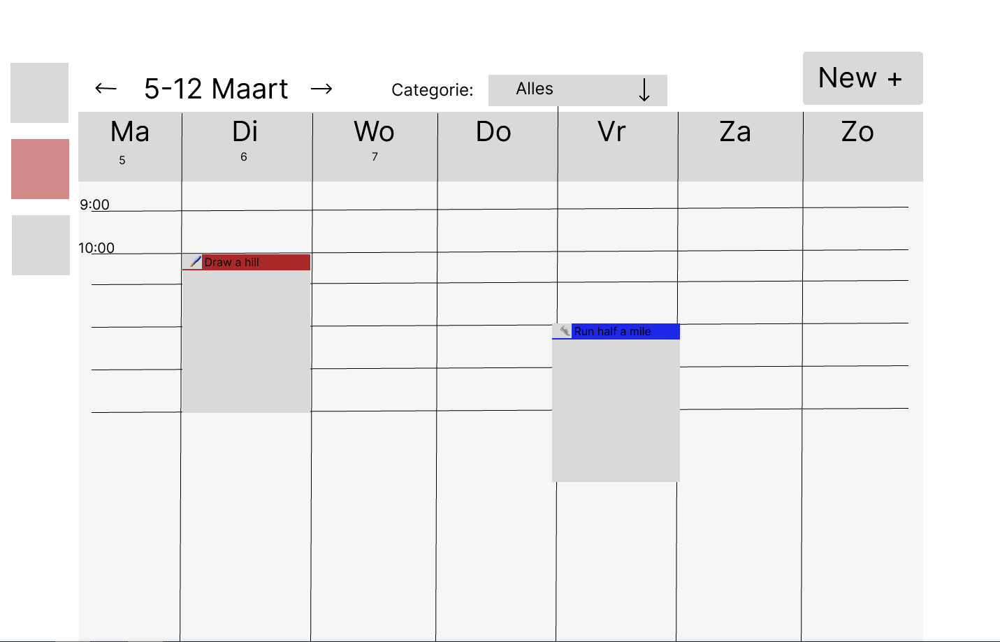

# MvH-Stage-Opdracht-Hobby-Agenda

# Concept

De hobby agenda is een agenda waarin men een planning bij kan houden over hun hobby's. De app heeft een startpagina waarin ze hun bestaande planning kunnen zien in een maand, week of chronologische lijstweergave, een detailpagina waarin de gebruiker de details kan zien van een bestaand agendapunt, en een modal waarin een gebruiker een nieuw agendapunt aan kan maken.

De gebruiker moet agendapunten kunnen maken, bekijken in een overzicht en in detail, kunnen aanpassen en kunnen verwijderen. 

De gebruiker moet nieuwe hobbycategorieën kunnen maken, bewerken of verwijderen.

Op de overzichtpagina moet de gebruiker kunnen filteren op een, meerdere of alle hobbycategorieën.

## Domeinbeschrijving

Elk agendapunt heeft een titel, een optionele beschrijving voor notities, een begintijdstip, een eindtijdstip en een categorie.

Een categorie heeft een naam, een icoontje en een kleur. 

## Wireframes

Wireframes zijn gemaakt met figma.


Maandweergave


Weekweergave

# Instructies

```shell
cd hobby-agenda
npm run dev
``` 
Start een server op.

# Retrospective

## Gemaakte keuzes
Voor deze opdracht heb ik geen gebruik gemaakt van AI. Ik heb nog nooit AI gebruikt bij fullstack ontwikkeling, dus voor deze opdracht beginnen leek mij een slecht idee. Ook is het doel van deze opdracht dat ik mijn vaardigheden laat zien, niet de vaardigheden van Grok.

Bij aanvang begon ik met het kort herformuleren van de opdracht, om de ambiguitijt te halen uit het document van de opdracht zelf, en om mijn eigen ideeën er aan toe te voegen. Hieruit volgde snel het uitschetsen van het domijn van de opdracht, die vrij simpel bleek te zijn. 

Hierna begon ik met het visueel ontwerp van de opdracht samenstellen in wireframes. Toen het eerste uur verstreken was stopte ik, omdat de belangrijkste pagina's waren weergegeven, op de chronologische view na. Ik dacht sowieso niet aan die pagina toe te komen, dus ik bewaarde het voor "later".

Hierna begon ik met het opzetten van het project zelf, waarin ik koos voor dezelfde tech stack die webbio hanteerd, omdat me dat het beste voor zou bereiden op het werk dat mij te wachten staat, en omdat ik binnen VueJS alleen ervaring heb met het werken binnen bestaande projecten, dus ik dacht dat mijn al aangeleerde skills mij bij deze opdracht niet veel zou helpen. 

Ik begon binnen het project met het samenstellen van de domeinklassen, en het mocken van voorbeelddata. Hierbij gebruikte ik als voorbeeld een van de voorbeeldprojecten van NextJS, omdat ik geen tijd had zelf iets te bedenken. Toen dit werkte ging ik over naar de layout van de homepagina, waarbij ik de Weekweergave koos om als eerst uit te voeren. Voor de hardcoded mock data was gekozen omdat ik het maken van de frontend een hogere prioriteit vond hebben dan het opzetten van een database met seed data. 

Het eerste frontend component dat ik maakte waren de kolommen van dagen in een week, maar toen ik de structuur af had realiseerde ik me pas hoe veel werk het handmatig invullen van een timetable zou zijn. Ik herinnerde me een video van Tom Scott waarbij hij data en tijd binnen IT het ingewikkeldste onderwerp noemde vanwege alle edge cases en gray area's. Ik besefte me dat deze realisatie de bedoeling van de opdracht was, dus besloot ik mijn werk weg te gooien en opnieuw te beginnen met een van de al bestaande React libraries voor het weergeven van een kalender, wat ik bij aanvang natuurlijk al had moeten doen.

Ik koos voor "react-big-calendar", omdat de andere suggestie "FullCalendar" overkill leek voor de scope van deze opdracht, en ik geen tijd had om beide te proberen. 

Dit leverde wat problemen op, omdat React-big-calendar bedoeld is om clientside te runnen, dus als je dat niet afdwingt binnen NextJS krijg je een vage "super expression must either be Null or a function" error. Ik had de voorbeeldcode van de library in een clientside component geïsoleerd toen de tijd was verstreken, dus loste ik een laatste nextJS error op en hield ik op met ontwikkelen. Het eindresultaat is bij verre na nog niet af volgens de eisen.

Uiteindelijk waren mijn grootste valkuilen dat ik niet zo veel meer wist van Typescript ontwikkeling dan ik dacht, waardoor ik voor best veel beslissingen hulp moest zoeken van google, en het eerst afwijzen van het gebruik van een kalender library. Hiermee ben ik veel tijd verloren.  
